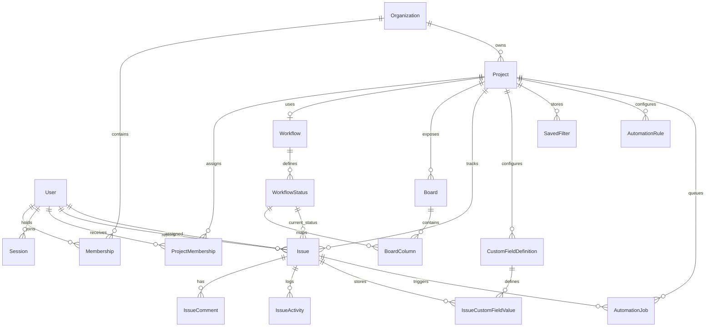

# Domain Model

The source of truth is `prisma/schema.prisma`: 18 models and 10 enums. The diagram shows the relations that the services actually use. `Organization` also has direct one-to-many relations to almost every model; those are left out to keep the picture readable.

`Project` to `Workflow` is optional one-to-one: `Project.workflow Workflow?` with `Workflow.projectId @unique` (`prisma/schema.prisma:150`, `:180`). The original diagram showed a mandatory `||--||`. The schema does not enforce that, which is why `issueService.createIssue()` checks `if (!project?.workflow)` (`src/services/issues/issueService.ts:156-158`).

## Enums (`prisma/schema.prisma:10-73`)

| Enum | Values | Where it matters |
| --- | --- | --- |
| `OrganizationRole` | `ORG_OWNER`, `ORG_ADMIN`, `MEMBER`, `VIEWER` | Only the first two are read (`src/lib/permissions/permissions.ts:29`) |
| `ProjectRole` | `LEAD`, `CONTRIBUTOR`, `OBSERVER` | Permission matrix (`permissions.ts:31-54`) |
| `WorkflowStatusCategory` | `TODO`, `ACTIVE`, `DONE` | Terminal-done rule (`src/services/workflows/workflowService.ts:35-48`); `ACTIVE` columns get `wipLimit` 5 (`src/repositories/projectRepository.ts:244`) |
| `CustomFieldType` | `TEXT`, `NUMBER`, `DATE`, `SINGLE_SELECT` | Value validation switch (`issueService.ts:67-97`) |
| `AutomationEventType` | `ISSUE_CREATED`, `ISSUE_STATUS_CHANGED` | Enqueued by `issueService.ts:226`, `:370` |
| `AutomationActionType` | `ADD_COMMENT`, `ASSIGN_USER` | Executed in `automationService.ts:156-197` |
| `AutomationJobStatus` | `PENDING`, `PROCESSING`, `COMPLETED`, `FAILED` | Queue state machine (`src/repositories/automationRepository.ts`) |
| `IssueActivityType` | six values | Every `createActivity` call |

## Entities

Each entry lists the schema location, the constraints that matter, who writes the model, and who reads it.

### Tenancy and identity

- **`User`** (`prisma/schema.prisma:75-90`). `email @unique`. Written only by `prisma/seed.ts`; there is no signup. Read by `authRepository.findUserByEmail()` (`src/repositories/authRepository.ts:14-25`).
- **`Session`** (`:92-105`). `tokenHash @unique`, `activeOrganizationId` is nullable with `onDelete: SetNull`. Written by `createSessionCookie()` and `updateSessionHeartbeat()`. Deleted on logout and in the orphan branch (`src/lib/auth/session.ts:105-110`).
- **`Organization`** (`:107-126`). `slug @unique`. Seed only. Read through memberships in `getSessionContext()`.
- **`Membership`** (`:128-139`). `@@unique([organizationId, userId])`, so each user has one role per org. Read by `authRepository.listMembershipsForUser()` on every request.

### Projects and configuration

- **`Project`** (`:141-162`). `@@unique([organizationId, key])`. Two tenants can both have `OPS`, and the seed does exactly that. Created by `projectRepository.createProjectGraph()` (`src/repositories/projectRepository.ts:165-263`) through `projectService.createProject()` (`src/services/projects/projectService.ts:19-68`).
- **`ProjectMembership`** (`:164-175`). `@@unique([projectId, userId])`. No `organizationId` column. The only runtime writer is `createProjectGraph`, which makes the creator `LEAD` (`projectRepository.ts:195-200`). Read by `findProjectAccess()` to produce `projectRole`.
- **`Workflow`** (`:177-188`). One per project. Created inside `createProjectGraph` (`projectRepository.ts:201-209`).
- **`WorkflowStatus`** (`:190-206`). `@@unique([workflowId, key])`. `isInitial` is a plain boolean (`:197`), so the database does not enforce "exactly one initial status". That rule lives in Zod (`createProjectSchema.superRefine`, `src/lib/validation/projectSchemas.ts:51-60`) and is defended again at read time by `requireInitialWorkflowStatus()` (`workflowService.ts:25-33`). Note that `requireInitialWorkflowStatus` picks the *first* initial status with `.find`. It would not notice two.
- **`Board`** / **`BoardColumn`** (`:208-222`, `:224-238`). One default board per project, with one column per status (`@@unique([boardId, statusId])`). Columns are created in the same transaction as the project (`projectRepository.ts:238-246`). `bootstrapService` sends the columns to the client as `selectedProject.statuses` (`src/services/bootstrap/bootstrapService.ts:135-147`). The UI's status dropdown therefore lists board columns, not workflow statuses.
- **`CustomFieldDefinition`** (`:289-307`). `@@unique([projectId, key])`. `config Json?` holds `{ options: string[] }` for `SINGLE_SELECT`. Created by `createProjectGraph` (`projectRepository.ts:248-259`). There is no endpoint to add fields later, even though `custom-field:manage` exists as a permission.

### Work items

- **`Issue`** (`:240-271`). `@@unique([projectId, sequenceNumber])`, which is the basis of keys like `OPS-3`. `statusId` uses `onDelete: Restrict`, so you cannot delete a status while issues use it. Written by `issueService.createIssue()` and `updateIssue()`, and by automation `ASSIGN_USER` (`src/services/automation/automationService.ts:188-196`).
- **`IssueComment`** (`:273-287`). `isSystem` marks automation comments. Written by `issueService.addComment()` and by automation `ADD_COMMENT` (`automationService.ts:163-172`). The `isSystem` input on `addComment()` (`issueService.ts:394`) is never passed by the comments route, so it is always `false` there.
- **`IssueActivity`** (`:383-400`). Append-only audit rows: `actorUserId` is nullable with `SetNull`, and `metadata Json?`. Only `STATUS_CHANGED` rows carry metadata (`{ fromStatusId, toStatusId }`, `issueService.ts:354-359`). Bootstrap returns only the latest 8 per issue (`src/repositories/issueRepository.ts:101-105`).
- **`IssueCustomFieldValue`** (`:309-323`). `@@unique([issueId, customFieldId])`, which makes the upsert at `issueRepository.ts:195-222` possible. `value Json?`.

### Filters and automation

- **`SavedFilter`** (`:325-341`). `projectId` is **nullable** with `onDelete: SetNull`, but `listVisibleFilters` always filters by `projectId` (`src/repositories/filterRepository.ts:20`). If a project were deleted, its filters would survive with `projectId = null` and never be listed again. `query Json` is validated on write by `filterQuerySchema` (`src/lib/validation/filterSchemas.ts:14-21`). The query also stores a `projectId` copy, which duplicates the column.
- **`AutomationRule`** (`:343-359`). `conditions Json?`, `actionPayload Json`, `isEnabled` defaults to true. Created by `automationService.createRule()`. Never updated by any code.
- **`AutomationJob`** (`:361-381`). `status`, `attempts`, `availableAt`, `processedAt`, `errorMessage`. Enqueued inside issue transactions. Claimed, completed, or failed by `automationRepository` (`:46-116`). `availableAt` is read by the claim query (`automationRepository.ts:53-55`) but nothing ever sets it to a future time, so there is no backoff or delay.

## Invariants: where each is enforced

| Invariant | DB constraint | App code |
| --- | --- | --- |
| Project key unique per org | `@@unique([organizationId, key])` | Pre-check in `projectService.ts:49-56` |
| Issue number unique per project | `@@unique([projectId, sequenceNumber])` | `max + 1` in `issueRepository.ts:152-164` |
| Exactly one initial status | none | Zod `superRefine`; `.find` at read time |
| Status belongs to issue's workflow | none (any `WorkflowStatus` id fits the FK) | `requireWorkflowStatus()` (`workflowService.ts:15-23`) |
| Assignee is a project member | none (`assigneeId` FK to any `User`) | `assertAssigneeIsProjectMember()` (`issueService.ts:113-132`) |
| Custom value matches definition type | none (`Json`) | `validateCustomFieldValues()` (`issueService.ts:40-111`) |
| Done is terminal | none | `assertValidStatusTransition()` (`workflowService.ts:39-48`) |

Every "none" row is an invariant that a direct database write, or a new code path that skips the service, can break. Automation's direct repository writes are one such path (see `docs/architecture/README.md`).

## Senior review findings

1. **Concurrent issue creation can fail with a 500.** `getNextSequenceNumber()` reads `MAX(sequenceNumber)` inside the transaction (`issueService.ts:171-177`). Under PostgreSQL's default READ COMMITTED isolation, two concurrent creates can read the same max. The second insert then fails the `@@unique([projectId, sequenceNumber])` constraint with Prisma error P2002. `handleRouteError()` does not recognize Prisma errors (`src/lib/http/responses.ts:20-52`), so the user gets "An unexpected server error occurred." (500). Fixes: a per-project counter row updated with `UPDATE ... RETURNING`, a retry on P2002, or SERIALIZABLE isolation with retry.
2. **The project key check has the same race.** `findProjectByKey` and then `createProjectGraph` (`projectService.ts:49-58`) is check-then-act. The unique index prevents duplicates, but the loser gets a 500 instead of the intended 409.
3. **Removing a project member does not unassign their issues.** `assigneeId` has no link to `ProjectMembership`. Membership is checked only at write time. There is no removal API today, but the model allows the state.

## Exercises

1. **Goal:** Find every model without its own `organizationId`.
   **Check:** In `prisma/schema.prisma`, `ProjectMembership` (`:164-175`), `WorkflowStatus` (`:190-206`), `BoardColumn` (`:224-238`), and `User` (`:75-90`) have none. Explain how each is still reached safely. Hint: `listProjectMembers` filters through `project: { organizationId }` (`src/repositories/projectRepository.ts:137-139`).
2. **Goal:** Explain why the client's status dropdown shows board column names.
   **Check:** `bootstrapService.ts:135-147` builds `statuses` from `projectSetup.boards[0]?.columns`. `workspace-shell.tsx:602-610` renders `column.status.name`. A status without a board column could not be selected in the UI, but the API would still accept its id.
3. **Goal:** Find the code that would break if a project had two `isInitial` statuses.
   **Check:** `requireInitialWorkflowStatus()` (`workflowService.ts:26`) returns the first one in `position` order (statuses are ordered at `projectRepository.ts:102-106`). Nothing errors, so the behavior silently depends on ordering.
