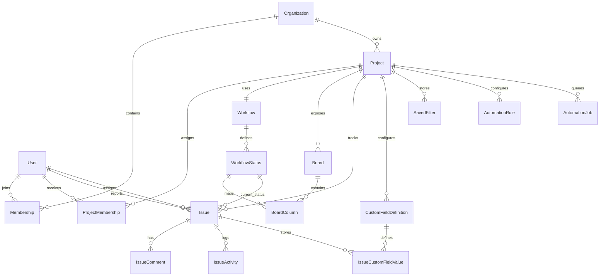

# Domain Model

## Entities

- `Organization`
  Schema: `prisma/schema.prisma` (`model Organization`)
  Primary service: `src/services/bootstrap/bootstrapService.ts` via `getWorkspaceBootstrap()` and `src/services/projects/projectService.ts` via `createProject()`
- `Membership`
  Schema: `prisma/schema.prisma` (`model Membership`)
  Primary service: `src/lib/auth/session.ts` via `getSessionContext()`
- `Project`
  Schema: `prisma/schema.prisma` (`model Project`)
  Primary service: `src/services/projects/projectService.ts` via `createProject()`
- `ProjectMembership`
  Schema: `prisma/schema.prisma` (`model ProjectMembership`)
  Primary service: `src/lib/auth/request-context.ts` via `requireProjectAccess()`
- `Workflow`
  Schema: `prisma/schema.prisma` (`model Workflow`)
  Primary service: `src/services/workflows/workflowService.ts`
- `WorkflowStatus`
  Schema: `prisma/schema.prisma` (`model WorkflowStatus`)
  Primary service: `src/services/workflows/workflowService.ts` via `requireWorkflowStatus()` and `assertValidStatusTransition()`
- `Board` / `BoardColumn`
  Schema: `prisma/schema.prisma` (`model Board`, `model BoardColumn`)
  Primary service: `src/services/bootstrap/bootstrapService.ts` when building board columns for the dashboard
- `Issue`
  Schema: `prisma/schema.prisma` (`model Issue`)
  Primary service: `src/services/issues/issueService.ts`
- `IssueComment`
  Schema: `prisma/schema.prisma` (`model IssueComment`)
  Primary service: `src/services/issues/issueService.ts` via `addComment()`
- `IssueActivity`
  Schema: `prisma/schema.prisma` (`model IssueActivity`)
  Primary service: `src/services/issues/issueService.ts` and `src/services/automation/automationService.ts`
- `CustomFieldDefinition`
  Schema: `prisma/schema.prisma` (`model CustomFieldDefinition`)
  Primary service: `src/services/projects/projectService.ts` during project creation and `src/services/issues/issueService.ts` during issue validation
- `IssueCustomFieldValue`
  Schema: `prisma/schema.prisma` (`model IssueCustomFieldValue`)
  Primary service: `src/services/issues/issueService.ts`
- `SavedFilter`
  Schema: `prisma/schema.prisma` (`model SavedFilter`)
  Primary service: `src/services/filters/filterService.ts`
- `AutomationRule`
  Schema: `prisma/schema.prisma` (`model AutomationRule`)
  Primary service: `src/services/automation/automationService.ts` via `createRule()`
- `AutomationJob`
  Schema: `prisma/schema.prisma` (`model AutomationJob`)
  Primary service: `src/services/automation/automationService.ts` via `enqueueIssueEvent()` and `processPendingJobs()`
